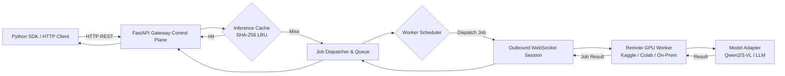

# VLM Serving Platform

Nền tảng phục vụ (serving) và đánh giá mô hình Thị giác - Ngôn ngữ (Vision-Language Models - VLM) hiệu năng cao, tối ưu hóa cho phần cứng GPU có giới hạn tài nguyên như **NVIDIA Tesla T4 (16GB VRAM)** trên Kaggle / Colab và máy chủ GPU Production.

* **Kế hoạch phát triển:** [KEHOACH.md](KEHOACH.md)
* **Báo cáo đánh giá kiến trúc & Roadmap:** [reports/ARCHITECTURE_REVIEW_2026-11-27.md](reports/ARCHITECTURE_REVIEW_2026-11-27.md)
* **Đặc tả API Contract (Chuẩn OpenAI):** [docs/api_contract.md](docs/api_contract.md)
* **Sổ tay triển khai Production:** [docs/deployment_runbook.md](docs/deployment_runbook.md)
* **Hướng dẫn Cloudflare Tunnel:** [infra/cloudflare/setup_tunnel.md](infra/cloudflare/setup_tunnel.md)

---

## 1. Kiến trúc hệ thống

Hệ thống hoạt động theo mô hình **Outbound WebSocket (Reverse Gateway)**, giải quyết triệt để rào cản mạng khi GPU chạy trên Kaggle/Colab (môi trường chặn toàn bộ port inbound/ingress):



### Các tính năng cốt lõi:
- **Tương thích chuẩn OpenAI**: Hỗ trợ đầy đủ endpoint `/v1/chat/completions` (đa phương thức và thuần văn bản), `/v1/models`, `/health`, `/metrics`.
- **Ràng buộc bảo mật & Session Ownership**: Xác thực token 2 chiều, ràng buộc phiên WebSocket theo từng socket kết nối, chặn giả mạo heartbeat và job result từ worker khác.
- **Hàng đợi & Điều phối thông minh (Scheduler)**: Hỗ trợ các chiến lược `least_loaded`, `round_robin`, `model_affinity` với nhận diện alias (`qwen3-vl-2b` $\leftrightarrow$ `Qwen/Qwen3-VL-2B-Instruct`).
- **Bộ nhớ đệm thông minh (Inference Cache)**: Lưu trữ kết quả suy luận với khóa băm SHA-256 canonical (bảo toàn cấu trúc ranh giới tin nhắn, vai trò role và các tham số sampling `extra_params`). Khi cache hit, tự động tạo mới envelope, ID và timestamp.
- **Trích xuất tài liệu có cấu trúc (`/v1/extract`)**: Trích xuất thông tin hóa đơn (Invoice) sang JSON với cơ chế kiểm tra bằng chứng (evidence check), phân định rõ trạng thái `completed` và `partial`.
- **Hỗ trợ ảnh lớn & Xử lý an toàn**: Nâng trần WebSocket payload lên 32 MiB, kiểm tra MIME/magic bytes, phòng chống SSRF và tối ưu hóa kích thước ảnh tự động (`DynamicResizer`).

---

## 2. Cấu trúc mã nguồn

```text
VLM-Serving-Kaggle/
├── apps/
│   └── gateway/               # Gateway Control Plane (app, dispatcher, registry, scheduler, server)
├── packages/
│   ├── caching/               # InferenceCache (SHA-256 băm xác định, LRU eviction, TTL)
│   ├── contracts/             # Pydantic schemas (Chat, Extraction, Models, Protocol, Errors)
│   ├── image_processing/      # Decoder, MIME/pixel validation, Lanczos resizer, SSRF safety
│   ├── model_adapters/        # BaseModelAdapter, MockAdapter (kiểm thử), QwenVLAdapter
│   ├── telemetry/             # Request ID context propagation, JSON logging, metrics Prometheus
│   └── worker_runtime/        # Worker API, executor chia sẻ, RemoteWorkerClient WebSocket
├── client/                    # Python Client SDK (VLMClient, chat_image, extract)
├── notebooks/
│   └── kaggle_worker.ipynb    # Jupyter Notebook chạy Remote Worker trên GPU Kaggle T4
├── evaluation/                # Suite đánh giá chất lượng & hiệu năng
│   ├── datasets/              # Bộ 50 mẫu vàng tiếng Việt (Invoice, OCR, VQA)
│   ├── quality/               # CER, WER, Exact Match, Field F1, ANLS
│   ├── performance/           # Đo p50/p95 latency, throughput, peak VRAM
│   ├── qualitative/           # Phân loại lỗi theo taxonomy 8 nhóm
│   ├── runner.py              # Runner đánh giá benchmark
│   └── ablation_runner.py     # Runner phân tích đa mục tiêu & Pareto frontier
├── infra/
│   ├── cloudflare/            # Hướng dẫn & file mẫu cấu hình Cloudflare Tunnel
│   ├── docker/                # Dockerfile Gateway, Dockerfile Worker GPU, Compose files
│   └── monitoring/            # Cấu hình Prometheus scraper
├── tests/
│   ├── unit/                  # Unit tests (contracts, caching, registry, scheduler, architecture fixes)
│   ├── integration/           # Integration tests (client E2E, gateway-worker WebSocket E2E, worker API)
│   └── fault_injection/       # Kiểm thử chịu lỗi (timeout, queue full, disconnect, reconnect)
├── research/
│   └── ocr_benchmark/         # Nhánh nghiên cứu OCR độc lập (PaddleOCR vs DeepSeek)
├── pyproject.toml             # Cấu hình dự án & dependencies
└── README.md
```

---

## 3. Hướng dẫn sử dụng nhanh

### 1. Cài đặt môi trường
Khuyến nghị sử dụng Python 3.10+:
```bash
pip install -e .
```

### 2. Khởi chạy Gateway Control Plane
```bash
# Khởi chạy bằng lệnh module
python -m apps.gateway.server --host 0.0.0.0 --port 8000 --token vlm_worker_secret_2026
```
Hoặc qua biến môi trường (ưu tiên cho Docker/Kubernetes):
```bash
export VLM_WORKER_AUTH_TOKEN="vlm_worker_secret_2026"
export VLM_CLIENT_API_KEY="my_client_key"  # Tùy chọn xác thực client
python -m apps.gateway.server
```

### 3. Kết nối Remote Worker từ Kaggle GPU (Tesla T4)
1. **Tạo Tunnel công khai**:
   ```bash
   cloudflared tunnel --url http://localhost:8000
   ```
   Lấy URL WSS được cấp (ví dụ: `wss://random-subdomain.trycloudflare.com/workers/connect`).
2. **Khởi chạy trên Kaggle**:
   Mở notebook [notebooks/kaggle_worker.ipynb](notebooks/kaggle_worker.ipynb) trên Kaggle GPU (chọn runtime GPU T4 x2 hoặc P100), điền `GATEWAY_WS_URL` và chạy toàn bộ cells để worker kết nối về Gateway.

### 4. Sử dụng Python Client SDK
```python
from client import VLMClient

# Kết nối tới Gateway hoặc Worker
client = VLMClient(base_url="http://127.0.0.1:8000")

# 1. Kiểm tra trạng thái Gateway & Worker
health = client.get_health()
print(f"Trạng thái: {health.status}")

# 2. Hội thoại đa phương thức với ảnh (Multimodal Chat)
resp = client.chat_image(
    image="data/sample_invoice.jpg",
    prompt="Hãy đọc và tóm tắt thông tin trên hóa đơn này.",
    model="qwen3-vl-2b",
)
print("Assistant:", resp.choices[0].message.content)

# 3. Trích xuất thông tin hóa đơn có cấu trúc (Structured Extraction)
extract_res = client.extract(
    image="data/sample_invoice.jpg",
    schema_name="invoice",
)
print(f"Status: {extract_res.status}")
print("Dữ liệu trích xuất:", extract_res.data)
```

---

## 4. Đánh giá & Phân tích tối ưu (Ablation & Benchmark)

### Chạy Benchmark trên tập mẫu tiếng Việt
```bash
# Chạy với adapter mock để kiểm tra pipeline:
python -m evaluation.runner --adapter mock

# Chạy với mô hình thực tế trên GPU:
python -m evaluation.runner --adapter qwen --device cuda:0
```

### Phân tích đa mục tiêu Pareto (Ablation Study)
```bash
python -m evaluation.ablation_runner
```
Kết quả được xuất ra:
* Báo cáo phân tích chi tiết: [reports/ablation.md](reports/ablation.md)
* Đồ thị phân bố tối ưu: [reports/pareto_frontier.png](reports/pareto_frontier.png)

---

## 5. Triển khai Production với Docker & Prometheus

Khởi chạy cụm production bao gồm Gateway, GPU Worker và Prometheus scraper:
```bash
docker compose -f infra/docker/docker-compose.prod.yml up -d --build
```

- **Gateway Endpoint**: `http://localhost:8000`
- **Prometheus Telemetry**: `http://localhost:8000/metrics`
- **Prometheus Dashboard**: `http://localhost:9090`
- **Kiểm định tải & SLO**:
  ```bash
  python -m evaluation.load_test_runner --url http://127.0.0.1:8000 --requests 50 --concurrency 5
  ```
  Báo cáo tự động được ghi nhận tại [reports/slo_report.md](reports/slo_report.md).

---

## 6. Kiểm thử tự động (Test Suite)

Dự án duy trì hệ thống kiểm thử tự động toàn diện bao gồm Unit test, Integration test và Fault Injection test:

```bash
# Chạy toàn bộ 88 test cases bằng pytest:
python -m pytest -q
```

### Phân bổ bộ kiểm thử:
- **Unit Tests (`tests/unit/`) - 59 tests**:
  - `test_architecture_fixes.py`: Nghiệm thu các invariant bảo mật session, cache collision, CLI precedence, extraction evidence check, SDK gateway health.
  - `test_caching.py`: Khóa băm SHA-256 xác định, LRU eviction, TTL expiry.
  - `test_contracts.py`: Schema Pydantic cho chat, extraction, protocol và errors.
  - `test_dynamic_resizer.py`: Cơ chế tính toán visual tokens và ước lượng VRAM.
  - `test_gateway_registry.py` & `test_scheduler.py`: Đăng ký worker, prune stale session, thuật toán cân bằng tải Least-Loaded & Model Affinity.
  - `test_image_processing.py`: Validate định dạng ảnh, chống SSRF private IP, pixel bomb DOS.
- **Integration Tests (`tests/integration/`) - 18 tests**:
  - `test_gateway_worker_e2e.py`: Luồng thực Client $\rightarrow$ Gateway (HTTP) $\rightarrow$ Outbound WebSocket $\rightarrow$ Worker.
  - `test_client_e2e.py`: SDK client end-to-end.
  - `test_worker_api.py`: FastAPI worker runtime.
  - `test_load_and_slo.py`: Kiểm định tải đồng thời.
- **Fault Injection & Resilience Tests (`tests/fault_injection/`) - 5 tests**:
  - Chịu lỗi timeout 504, hàng đợi đầy 429, worker ngắt kết nối đột ngột, tự động reconnect và khôi phục.
- **Research OCR Benchmark Tests (`research/ocr_benchmark/tests/`) - 6 tests**:
  - Kiểm định tính nhất quán của nhánh nghiên cứu so sánh OCR độc lập.

> **Trạng thái kiểm thử:** **`88 passed, 0 failed`** (100% green).
