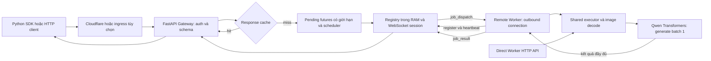

# VLM Serving Platform: architectural onboarding và roadmap nâng cấp

Ngày đánh giá: **27/11/2026, Asia/Bangkok**. Phạm vi: source hiện tại, test, cấu hình deployment, provenance benchmark và blueprint; **chưa triển khai các refactor vào ứng dụng**.

## 1. Kết luận điều hành

Repository có nền tảng tốt cho một hệ serving thử nghiệm: contract dùng chung, hai đường Worker HTTP / reverse WebSocket, executor dùng chung, adapter độc lập, giới hạn ảnh, queue admission có giới hạn, heartbeat/reconnect và test qua HTTP/WebSocket thật với inference giả lập. Tuy nhiên, **chưa đủ bằng chứng để gọi là production-ready hoặc đã chứng minh tối ưu trên T4**. Các điểm nghẽn ưu tiên hiện nay là tính đúng đắn của lifecycle job, cache và contract; chất lượng bằng chứng đánh giá; cùng đường cấu hình/dependency khi deploy. Continuous batching là bước tiếp theo có giá trị, nhưng không giải quyết các lỗi này.

Ba điều chỉnh quan trọng đối với mandate ban đầu:

1. Hiện có **80 tests**, không phải 78. `python -m pytest -q` thực thi thành công **80 passed, 3 warnings in 53.50s** trên Python 3.13.2. Test vận chuyển chạy local HTTP/WebSocket, còn inference dùng MockAdapter hoặc scripted worker; không phải benchmark GPU.
2. Multi-image đã có ở mức source trong `executor.py` và `qwen_vl.py`; INT4/INT8 đã có nhánh cấu hình load. Chưa có bằng chứng runtime hay test Qwen thật cho các nhánh này. Không nên xây lại từ đầu hoặc ghi “chưa có”.
3. Streaming xuyên Gateway → WebSocket → Worker → adapter là thay đổi nhiều lớp, không phải quick win chỉ thêm `StreamingResponse`. `stream` hiện được schema nhận nhưng bị bỏ qua.

**Thứ tự đề xuất:** khép lỗi correctness/config và sửa provenance benchmark → đo baseline Qwen thật → streaming và constrained extraction → engine sidecar có continuous batching → multi-page/grounding theo nhu cầu → HA khi có yêu cầu availability/capacity thật.

## 2. Snapshot và mức độ khảo sát

HEAD: `8d7a0532420a9ebfa75cc54fb0295e7a7a97c904`, branch `cleanup/repo-consolidation`. Không có `.codegraph/` tại root, vì vậy khảo sát bằng source và AST. Worktree trước audit đã thay đổi các tệp gateway/runtime/Qwen/scheduler/tests, thêm `executor.py` và notebook mới, xóa `CLEANUP_AUDIT.md` cùng notebook Phase 2 cũ. Audit giữ nguyên các thay đổi đó.

`CLEANUP_AUDIT.md` được đọc từ **`git show HEAD:CLEANUP_AUDIT.md`**, không phải tệp đang có trên đĩa. Các tuyên bố 78 tests trong đó là lịch sử, không phải kết quả hiện tại. README vẫn trỏ `notebooks/kaggle_worker_phase2.ipynb`; notebook hiện có là `notebooks/kaggle_worker.ipynb`.

| Nhóm bắt buộc | Nội dung đã đối chiếu | Độ sâu / bằng chứng |
|---|---|---|
| Architecture/master plan | `KEHOACH.md`, `README.md`, cleanup audit từ HEAD, `docs/api_contract.md`, `docs/deployment_runbook.md` | Đọc tài liệu và so với entrypoint/call path; checklist hoàn thành không thay bằng chứng runtime |
| Gateway | `app.py`, `server.py`, `config.py`, `dispatcher.py`, `registry.py`, `scheduler.py` | Đọc các luồng route, auth, cache, acquisition, timeout, cleanup, heartbeat, result |
| Worker | `remote_client.py`, `server.py`, `app.py`, `manager.py`, **`executor.py`** | Đọc đường direct và reverse; executor là thành phần mới ngoài danh sách mandate |
| Multimodal/model/cache | Toàn bộ module contracts, decoder/validator/safety/resizer/dynamic_resizer, cache, base/mock/Qwen | Đọc logic hiện hành, kiểm tra caller, probe các bất biến |
| Evaluation | runner, ablation, load test, Pareto, performance aggregator, dataset manifest/builder/schema | Đối chiếu phép đo thực, số giả lập, mẫu số lỗi và nguồn ảnh; xem trực tiếp `vqa_001.jpg` |
| Telemetry/deploy | logging/metrics/timer/context, hai Dockerfile, Compose production, Prometheus, CI, notebook | Đọc cấu hình và code dùng config; Compose config parse thành công; chưa build/run image |
| OCR research | README, PHASE1_RESEARCH, adapters, comparison guards, scoring/benchmark lifecycle, tests, notebook builder inventory | Kiểm tra nhánh nghiên cứu độc lập; không chạy checkpoint/dataset Kaggle |
| Tests | `tests/unit`, `tests/integration`, `tests/fault_injection`, research tests | Chạy toàn bộ 80; đọc sâu các test API, adapter, real remote client, fault, ablation/SLO; inventory AST các suite còn lại, không tuyên bố manual-review từng dòng của mọi test |

Inventory AST: **84 Python files**, **80 test methods**: unit **51**, integration **18**, fault injection **5**, research **6**. Nguồn chi tiết là `onboarding_2026-11-27/source_inventory.json`; các nhãn phase lịch sử trong README không đủ để suy ra coverage.

Artifacts tái lập của audit: `onboarding_2026-11-27/probe.py`, `probe_results.json`, `source_inventory.json`. Inventory lưu hash/line count để phát hiện source thay đổi sau snapshot; inventory không chứng minh đã manual-read toàn bộ 84 files.

## 3. Kiến trúc thực tế và chủ sở hữu



Sơ đồ mô tả luồng theo source; Cloudflare không được khởi chạy/xác nhận trong audit. “WebSocket Queue” thực chất là map các future đang pending cộng polling worker mỗi 50 ms, **không phải durable FIFO/broker**.

- Gateway sở hữu external auth, admission, worker selection, pending futures và response cache. Gateway chưa decode ảnh: Pydantic validate hình dạng request, worker mới kiểm tra bytes/pixels/URL.
- Worker sở hữu tải model, decode ảnh, preprocessing, generation, parse extraction. Direct API dùng `ModelManager.lock`; remote dùng `_execution_lock`; cả hai gọi shared executor bằng `asyncio.to_thread`.
- Adapter Qwen dùng processor, EXIF/RGB/resize, eager attention mặc định, `generate()` đồng bộ và decode sau khi hoàn tất. GPU synchronization/peak memory đang hard-code device 0 dù device config có thể là GPU khác.
- EvaluationRunner gọi adapter trực tiếp, không đo queue/tunnel/API. LoadTestRunner gọi gateway nhưng chỉ gửi text với model Qwen2 cố định.
- SDK có `chat`, `chat_image`, `extract`, health/models và structured exceptions. CLI đã có cho Gateway, Worker, evaluator/load test; **SDK/CLI không phải tính năng hoàn toàn thiếu**.

Điểm mạnh đáng giữ: shared contracts và executor tránh hai logic extraction khác nhau; adapter lifecycle tách control plane; OOM/failure được trả lỗi; image byte/pixel/format validation cùng EXIF và resize; cache TTL/LRU đã có; queue reserve có lock; local transport/fault tests có giá trị thật ở tầng hạ tầng.

## 4. Findings có ảnh hưởng trực tiếp đến ưu tiên

### F01 — Bằng chứng benchmark hiện tại chưa đủ cho quyết định tối ưu — P0

`evaluation/ablation_runner.py:66` không inference trên `samples`: dùng ảnh trắng, công thức latency/VRAM, F1/CER gán sẵn; `:195` đo MockAdapter rồi **cộng hằng số 1.25 ms** để tạo gateway overhead. Pareto còn có điểm cache gán sẵn. Default dataset là `benchmark_50_gold.jsonl`, trong khi manifest hiện có tên `vietnamese_benchmark_50.jsonl`; file thiếu trả `[]`, pipeline vẫn xuất report. `reports/ablation.md` không ghi nổi bật SIMULATED và có diễn giải như thực nghiệm.

`evaluation/datasets/builder.py` sinh toàn bộ 50 ảnh bằng Pillow. 15 VQA là chữ “Nội dung minh họa: <answer>” thay vì cảnh/biểu đồ tương ứng; đã xem ảnh `vqa_001.jpg` xác nhận. Các tag `photographed/low-light` không được hỗ trợ bằng ảnh chụp thật trong builder; OCR có tiêu đề ngoài ground truth trong khi prompt yêu cầu toàn bộ chữ. Đây là **fixture tổng hợp để kiểm tra pipeline**, chưa phải gold set đại diện cho thị giác hoặc hóa đơn thực tế.

`reports/slo_report.md` thiếu metadata model/backend/hardware để chứng minh nguồn số cũ; không thể kết luận chắc toàn bộ provenance chỉ từ Markdown. Tuy nhiên runner và test hiện hành cho phép tạo report PASSED từ scripted worker, nên **report này không chứng minh SLO T4**. Không dùng các số đó làm baseline.

Sửa đề xuất: trường `evidence_kind=SIMULATED|MOCK|MEASURED_GPU`, config+dataset hash, raw per-request records; simulator xuất thư mục/tên riêng; evaluator thật fail nếu thiếu dataset; dev/test riêng, ảnh thật đã kiểm nhãn, review blind; giữ fixture cũ cho CI. Quality hiện aggregate chỉ completed, cần thêm end-to-end metric tính failed/oom/timeout theo policy công khai. Pareto chỉ so các điểm cùng workload/provenance.

### F02 — Timeout/cancel chưa đồng nghĩa GPU đã dừng — P0

`apps/gateway/dispatcher.py:114` timeout gửi `GatewayJobCancel`, rồi `finally` gọi `_cleanup_job` (`:257`) giảm in-flight và đánh dấu idle. `packages/worker_runtime/remote_client.py:177` chỉ log cancel. Task inference tạo bằng `create_task` không được giữ trong map để hủy/drain. `to_thread` không cho phép cưỡng bức dừng thread GPU bằng `Task.cancel()`.

Hệ quả: client đã nhận 504 nhưng GPU vẫn sinh; gateway có thể nhận thêm job trong khi worker thực còn bận. Lock ngăn generation đồng thời, nhưng job bị dồn trong task chờ không có admission riêng, làm sai timeout/capacity. Reconnect có thể để task phiên cũ còn chạy hoặc cố gửi vào socket cũ.

Thiết kế cần có `queued → running → cancel_requested → cancelled|completed|failed|unknown`, absolute deadline bắt đầu ở admission, task registry theo job và session epoch; cooperative stopping criteria/engine abort; cancel ACK và terminal outcome; chỉ release capacity khi backend dừng thật, hoặc cách ly worker nếu chưa biết. Không tự retry execution không rõ kết quả. Deadlines phải bao gồm queue wait, send và inference; hiện acquisition tối đa 2 giây nằm ngoài `wait_for(future)`.

### F03 — Cache có thể trả kết quả không thuộc cùng ngữ nghĩa request — P0

`dispatcher.py:65` nối texts bằng space, bỏ roles/boundaries và mọi `extra_params`; key không có model revision, preprocessing version, tenant hay engine config. Probe cho thấy một message `"a b"` và hai message `"a"`, `"b"` trùng key; đổi `top_p` cũng trùng key. URL được hash theo string, không theo content; cùng URL thay bytes vẫn có thể trả dữ liệu cũ. Cache bật mặc định cả request sampling.

Cache response hiện lưu cả completion ID/created, extraction request_id và timing cũ; hit có thể trả trace/timing của request trước. Cache SHA-256 không khắc phục việc đầu vào key sai. `InferenceCache` có LRU+TTL nhưng chỉ expire khi get, giới hạn số entry thay vì bytes; `saved_latency_ms` có fallback 250 ms mang tính giả định; docstring “thread-safe” không có lock.

Sửa key trước eviction: canonical full payload, model deployment fingerprint, namespace quyền truy cập, image content identity; mặc định bypass URL/sampling/stream/unknown options cho đến khi có policy. Cache semantic payload và tạo envelope/timing mới ở mỗi response. TTL/byte-budget/expiry sweep và single-flight là tối ưu sau đó. Response cache, image-feature cache và KV prefix cache là ba cơ chế khác nhau; repo hiện có cơ chế thứ nhất.

### F04 — Config và deployment không khép kín với runbook — P0

`apps/gateway/server.py:22` truyền `worker_auth_token=args.token or <default literal>` và `client_api_key=args.client_key` kể cả None. Điều này ghi đè env defaults từ GatewayConfig: với CMD Docker không có flags, key client trong Compose **không được áp dụng**, custom worker token cũng không được áp dụng. Probe intercept CLI construction để kiểm chứng mà không mở server. Các env `VLM_ENABLE_CACHE`, cache size và scheduler trong runbook không được parse bởi GatewayConfig.

`infra/docker/Dockerfile.worker_gpu` chỉ `pip install .`, trong khi transformers/accelerate nằm trong extra `[gpu]`; base PyTorch image không phải môi trường Transformers được pin. Không có bước cài Transformers rõ ràng cho Qwen. Hai Dockerfile install package trước COPY source/README; cần sửa packaging layer và test import từ wheel độc lập, không mặc định dựa vào cwd. `pyproject.toml` chỉ discover `packages*`, `client*`, không đóng gói `apps*`. CI chỉ build gateway, chưa build/smoke worker GPU. Production Compose/notebook dùng Qwen2, worker CLI mặc định Qwen3, revision không bắt buộc.

Health Docker gateway dùng `/health` luôn trả HTTP 200 kể cả degraded; GPU worker chỉ `nvidia-smi`, không chứng minh adapter ready/kết nối. Đổi gateway Docker check sang `/health/live` để tránh vòng phụ thuộc worker cần gateway-start; ingress readiness dùng `/health/ready`. Worker readiness kiểm model/engine và session. `restart: unless-stopped` phục hồi process đã thoát, không chứng minh tự phục hồi process inference bị treo. Runbook rollback chưa chỉ rõ image digest/revision thật sự được tiêu thụ.

### F05 — Session ownership và budget transport chưa được enforce — P0 trước public ingress

`app.py:314` tin `hb.session_id` trong payload thay vì buộc bằng session của socket; `:319` gọi `resolve_job(result)` không truyền sender. Dispatcher chỉ kiểm job_id đang pending, không ràng buộc sender/session/request_id. Probe nội bộ chấp nhận result với request_id không khớp. Đây là thiếu invariant giữa các worker đã xác thực, không phải chứng minh anonymous Internet biết job IDs.

Đề xuất bind heartbeat/result/chunk/cancel ACK với authenticated socket session+epoch và expected job owner; kiểm endpoint-specific response schema trước resolve/cache. Registration cần timeout/size bound; max jobs/bytes và task ownership ở worker. `websockets.connect()` hiện không đặt `max_size`; phiên bản cài 16.1.1 mặc định **1,048,576 bytes**. Ảnh hợp lệ 20 MiB qua base64/JSON vượt trần transport đó. Cần test E2E payload lớn, thống nhất HTTP body/encoded bytes/decoded bytes/message size tại cả hai đầu và ingress; không đặt `max_size=None` rồi bỏ resource bound.

Decoder hiện full-buffer HTTP/base64 trước khi kiểm 20 MiB; nhiều ảnh không có tổng count/bytes/pixels budget. `safety.py` kiểm DNS rồi httpx resolve lại, nên chưa loại TOCTOU/rebinding; không redirect là điểm tốt. API dùng chung decoder có hỗ trợ local Path/string và runtime không truyền allowlist; phải tách input policy API với trusted local evaluator, giới hạn fetch streaming, pin egress/allowlist. Không thử khai thác ra mạng trong audit.

### F06 — Contract và OpenAI compatibility mới ở mức subset — P1

- `chat.py:43` có `stream`, nhưng Gateway và direct worker luôn trả JSON đầy đủ. Probe `stream=true` trả `application/json`.
- `get_user_prompt()` ghép system/user và bỏ assistant; Qwen tái tạo một user turn và đưa tất cả ảnh lên trước prompt. Mất role/history/interleaving; không thể gọi full OpenAI chat semantics. Multi-image đã wire nhưng chưa bảo toàn vị trí/giới hạn token.
- Direct worker lấy adapter hiện hành bất kể payload.model. Probe model không tồn tại vẫn 200. Gateway substring match có phân biệt hoa/thường: alias SDK mặc định `qwen3-vl-2b` không match canonical `Qwen/Qwen3-VL-2B-Instruct`; phải dùng bảng alias tường minh.
- `client/vlm_client.py:126` parse worker HealthResponse, trong khi Gateway `/health` có schema khác. Probe `get_health()` qua Gateway gây ValidationError. Cần thêm GatewayHealthResponse + method SDK tương ứng, giữ method cũ cho worker; nếu muốn một method đa endpoint, dùng union có discriminator/compatibility tests.
- Unknown top-level fields theo Pydantic mặc định có thể bị bỏ qua; `extra_params` không phải toàn bộ sampling options đều được Qwen dùng, còn key trùng `prompt/image/max_tokens/temperature` có thể gây TypeError ở executor. Cần allowlist/validation và không silently ignore.
- Worker định dạng lỗi 400/503 riêng; Gateway biến remote failure thành 500 string, auth/validation/404 không đồng nhất ErrorResponse. Thêm structured remote error envelope có HTTP mapping, giữ mã lỗi cũ đã công bố hoặc version hóa; client parser test cả hai giai đoạn migration.

### F07 — Structured extraction “completed” quá dễ đạt — P1

`executor.py:23` bóc fence/ngoặc rồi Pydantic parse. InvoiceData mọi trường chủ yếu optional, currency mặc định VND; **`{}` được trả status completed** với dữ liệu null/default, đã probe. Unknown schema được coi completed nếu parse ra dict. Không có grammar ở logits, không validate ngày/tổng tiền bằng business rules, không bảo đảm những field được yêu cầu có evidence. Fixed max_tokens=512 có thể truncation JSON nhưng status không bắt buộc dựa vào finish_reason.

Cần tách: syntax valid, schema valid, requested-field coverage, source grounding, business consistency và abstention/null. Constrained decoding chỉ giúp syntax/schema trong tập tính năng engine hỗ trợ; lỗi/OOM/timeout/truncation/refusal vẫn tồn tại. **Không hứa 100% mọi request thành JSON đầy đủ, càng không hứa 100% extraction đúng.** Instructor kiểu validation/retry không tự tương đương token-level grammar; chọn công cụ theo cơ chế thực tế.

### F08 — Observability chưa đo được bottleneck VLM — P1

Metrics hiện có requests/status/latency histogram/workers/pending/cache/VRAM và structured log request ID. Thiếu TTFT, TPOT/ITL, queue wait, image count/actual visual tokens, encoder/prefill/decode, timeouts/cancel/late-results, engine queue/KV usage và per-worker health. Remote execution không set contextvars từ dispatch.request_id nên log worker có thể thiếu trace dù response extraction có request ID.

Histogram label lấy raw path/model từ input có nguy cơ cardinality và thiếu escape; filter route template/model deployment allowlist, không gắn request IDs/URLs. Worker heartbeat đang báo torch allocated bytes, không phải whole-device peak; sampler mỗi 5 giây dễ bỏ spike. Middleware hiện đo trước khi stream body kết thúc; khi thêm SSE phải instrument first data và completion/cancel bên trong stream lifecycle. Chưa có Grafana dashboard, alert rule file hay Alertmanager được wire; runbook nhắc alert không chứng minh đã có.

## 5. Đánh giá sáu trụ cột và thực hành serving hiện nay

| Trụ cột | Hiện trạng đã kiểm | Khoảng trống chính | Quyết định đề xuất |
|---|---|---|---|
| Inference engine | Transformers eager FP16 mặc định, generation batch 1, locks; có cấu hình SDPA/INT4/INT8 ở source | Không continuous batching/engine admission/KV metrics; dependency/quant chưa GPU-test | Giữ baseline; thử vLLM sidecar trước, so SGLang nếu compatibility/quality đạt |
| Streaming | Request schema có stream nhưng unary-only ở runtime | Adapter events → WS events → dispatcher stream → SSE → SDK chưa có | Additive protocol có negotiation; không chia chuỗi sau generate để giả TTFT |
| Multimodal | Nhiều ảnh đã qua executor/Qwen; decoder ảnh JPEG/PNG/WebP | Mất message ordering; không total visual-token budget; chưa PDF/grounding | Sửa message semantics/budgets; sau đó page rasterization và bbox contract |
| Extraction | Parse/fallback + InvoiceData | Thiếu constrained decode, coverage và semantic checks | Server-owned schema, engine grammar, validation và abstention |
| Availability/scaling | Single gateway RAM registry, bounded pending map, reconnect/backoff | Không durable job ownership, multi-gateway socket routing, HA/autoscaler | Lifecycle trước; broker/lease/owner routing sau, theo nhu cầu |
| DX/production | SDK/CLIs/tests/metrics/runbook đã có | Config không effective, health mismatch, lock versions/image, alert/recovery thiếu | Sửa sử dụng end-to-end trước khi bổ sung công cụ mới |

### Backend/hardware: lựa chọn dựa trên compatibility, chưa phải xếp hạng tốc độ

- **vLLM** là ứng viên đầu tiên cho engine service nhờ API multimodal, batching/KV management và quan sát engine. Docs GPU hiện nêu Linux và compute capability ≥7.5, có T4; điều đó **không chứng minh mọi tổ hợp Qwen3-VL/attention/quant/context chạy trên T4 16 GB**. Chọn release/image digest đã smoke, FP16, context và image budget giới hạn. Windows host không phải môi trường vLLM native theo docs. [GPU installation](https://docs.vllm.ai/en/latest/getting_started/installation/gpu/), [Qwen3-VL recipe](https://docs.vllm.ai/projects/recipes/en/stable/Qwen/Qwen3-VL.html).
- **SGLang** là đối chứng hợp lý về RadixAttention/prefix reuse và serving; docs hiện có hướng dẫn Linux/NVIDIA, versioned deployment và phương án kernel thay thế trên SM75 khi FlashInfer lỗi. T4 không phải lý do để loại tuyệt đối, nhưng phải kiểm dependency/CUDA/kernel/model cụ thể. Không cài chung vào env Transformers baseline. [Overview](https://docs.sglang.io/), [Installation](https://docs.sglang.io/docs/get-started/install).
- **TensorRT-LLM** nên để sau khi phần cứng/mô hình/traffic ổn định: matrix đã mở liệt kê Ampere/Ada/Hopper/Blackwell, không liệt kê Turing trong nhóm được nhóm tác giả phát triển/test. Matrix đó ghi cập nhật 15/09/2025 nên chỉ là bằng chứng cho trang/release đó, không chứng minh mọi release tương lai. Không lấy TensorRT-RTX hay TensorRT chung làm bằng chứng TensorRT-LLM hỗ trợ T4. [TensorRT-LLM support matrix](https://nvidia.github.io/TensorRT-LLM/reference/support-matrix.html).
- **FP8 không phải quick win mặc định cho T4.** Matrix vLLM phân biệt Turing-supported AWQ/GPTQ/bitsandbytes với FP8 W8A8 không được hỗ trợ trên Turing. INT4 weights không đồng nghĩa KV cache INT4 hay vision encoder INT4. Phải log quant format/backend/checkpoint và chấm chất lượng Việt/ngày/số tiền. [Quantization matrix](https://docs.vllm.ai/en/stable/features/quantization/).
- Qwen3-VL docs hiện yêu cầu Transformers ≥4.57.0; repo floor ≥4.40 không bảo đảm Qwen3 class/processor. Docs cũng mô tả Qwen3 image compression theo 32 thay vì heuristic Qwen2 28 đang dùng ở DynamicResizer. Dùng processor `image_grid_thw`/merge config và token counts thật làm authoritative, không gán công thức 0.85 MB/token là đo GPU. [Qwen3-VL official source](https://github.com/QwenLM/Qwen3-VL).
- Chunked prefill giúp chia long prefills và cùng batch decode; tune theo TTFT/ITL/throughput thay vì bật mọi tối ưu. Paged KV giúp decoder attention memory, không loại chi phí vision encoder hay thay response/image-feature cache. Disaggregated encoder/prefill/decode và speculative decoding chưa là ưu tiên của single T4. [vLLM tuning](https://docs.vllm.ai/en/stable/configuration/optimization/).

Đây là suy luận kiến trúc từ source và docs chính thức đã tra trong audit. Chưa có benchmark phần cứng chứng minh backend nào nhanh nhất cho workload này.

## 6. Roadmap ưu tiên theo impact/complexity và phụ thuộc

Ước lượng effort là **khoảng lập kế hoạch cho một engineer quen repo**, không phải cam kết deadline; không bao gồm chờ GPU/dataset/infra. Impact nói về lỗi hoặc năng lực giải quyết, không phải dự báo % speedup.

| Thứ tự / mức | Deliverable cụ thể và file owner | Impact / complexity / effort | Gate nghiệm thu |
|---|---|---|---|
| P0-A, nền tảng | Fix env precedence `gateway/config.py`, `server.py`; explicit aliases, sender ownership, structured error validation ở app/dispatcher/registry | Cao / thấp-vừa / 2–4 ngày | Env-only auth chạy đúng qua CLI+container; sai token 401; cross-session result/heartbeat bị từ chối; model sai không chạy |
| P0-B, nền tảng | Lifecycle/task/deadline/cancel trong dispatcher/remote/executor; websocket/body/total-image budget trong transport+decoder | Cao / vừa-cao / 3–6 ngày | Timeout không release GPU capacity sớm; cancel trước/chạy/late result; reconnect/drain; ảnh 1 MiB+ qua WS; oversize chặn trước full buffer |
| P0-C, Quick win | Canonical cache identity/envelope, policy bypass, byte budget + expiry trong cache/dispatcher | Cao / vừa / 2–3 ngày | Các collision probe thất bại như mong đợi; IDs/timing mới trên hit; no cross-deployment/tenant reuse; memory bounded |
| P0-D, Quick win | Provenance model/dataset/evidence_kind, simulator labeling, real evaluator path và failed-denominator | Cao / vừa / 2–4 ngày, chưa tính annotation | Thiếu dataset fail; mock/sim không tạo claim GPU; real gold review; JSONL tái lập paired run |
| P1-A, Level 1 | True streaming: additive contracts, adapter streamer, WS events, dispatcher iterator, HTTP SSE và SDK `stream_chat()` | Cao cho UX / vừa-cao / 4–7 ngày | First delta trước generation end; cancel propagates; sequence/terminal/backpressure; unary cũ không đổi |
| P1-B, Level 1 | Enhanced extraction schema + validation trước, grammar trên backend đã hỗ trợ; strict mode opt-in | Cao cho dữ liệu / vừa / 2–4 ngày sau engine integration | Missing/null/truncation/refusal/invalid schema rõ ràng; vẫn giữ legacy response/default |
| P2-A, Level 2 | `AsyncChatBackend`/engine bridge + vLLM sidecar, bounded concurrent submissions, optional SGLang implementation | Cao ở tải đồng thời / cao / 5–8 ngày + GPU qualification | Backend-specific readiness, model revision/config pin, C=1/2/4 quality+perf, abort và budget; baseline vẫn rollback được |
| P2-B, Level 2 | Preserve message role/interleaving; multi-image count/context budget; SDK helper | Cao nếu hội thoại/nhiều ảnh là use case / vừa / 2–4 ngày | Two-image order, image-text association, history/system, OCR parity, limits |
| P2-C, mở rộng use case | PDF rasterization service và page IDs; bbox grounding với normalized coordinates và transform metadata | Phụ thuộc nhu cầu / cao / 4–8 ngày mỗi vertical slice | PDF page/DPI/pixels/deadline budgets; không fetch URL ngoài policy; bbox round-trip EXIF/resize/page và IoU/evidence check |
| P3-A, Level 3 | Multi-gateway owner routing + Redis leases/Streams, fencing và durable job state | Cao khi cần HA / cao / 7–12 ngày + vận hành | Kill owner gateway, stale lease, duplicate result, Redis outage, capacity reconciliation; không đếm queue hai lần |
| P3-B, Level 3 | Grafana dashboards + Prometheus alert rules/Alertmanager, worker readiness/recovery, graceful drain | Cao cho vận hành / vừa / 2–4 ngày | Dashboards từ metrics thật; alert được fire/resolve thử; model crash/hang được nhận biết |
| P3-C, Level 3 | GPU worker discovery/autoscaling dựa pending age/token demand và warm-up | Có điều kiện / cao / 4–8 ngày sau P3-A | Cooldown/min-max/headroom; scale-in drain; engine-ready rồi mới nhận job; không scale Kaggle sessions |

Các hạng mục P1 có thể độc lập ở phần schema/formatter nhưng không release trước invariants P0. Tránh bật đồng thời thay backend, quantization và resolution khi so baseline.

### HA cần nhiều hơn một Redis registry

Socket và asyncio.Future thuộc process gateway đang giữ connection. Redis không serialize được socket/future. Thiết kế đề xuất: `worker → {owner_gateway, session_epoch, lease_expiry, capacity, deployment_fingerprint}`; admission gateway tạo durable job rồi gửi qua owner channel/stream; owner gateway gửi WS; result/chunk có sequence và publish về requester; terminal result persist có TTL. Reservation phải atomic và có fencing; queue có lease/ack/dead-letter, rate/byte bound.

Nếu owner chết, worker reconnect tạo epoch mới; job running chưa biết kết quả phải chuyển unknown/reconcile, không replay mù. Redis Pub/Sub đơn thuần có thể mất message nên không dùng làm durable queue. SSE connection vẫn có thể đứt khi gateway chết: HA giảm thời gian khôi phục, không tự bảo đảm stream liên tục; muốn resume cần durable deltas và API semantics riêng. Không chạy `uvicorn --workers N` với registry RAM rồi coi là HA.

Discovery thực chất đã có worker register; nâng cấp là unique identity/lease/capacity/deployment-aware routing. Autoscaler nên dùng queue age và token demand theo GPU pool, provisioning latency cùng cooldown, thay vì ngưỡng pending=20 gán sẵn.

## 7. Ba recipe refactor không phá đường unary hiện có

Đây là **blueprint chưa áp dụng**. Snippet là hạt nhân độc lập; wiring và test/gates được nêu ngay sau mỗi recipe. Không khẳng định zero regression cho code chưa triển khai. Giữ nguyên public methods `chat/chat_image/extract`, request cũ và response unary cũ; extension mặc định tắt hoặc negotiated. Không thêm abstract method bắt buộc vào BaseModelAdapter làm hỏng MockAdapter/consumer cũ.

### Recipe A — Cache key canonical với policy an toàn

Thêm helper nội bộ, gọi sau auth và canonical model resolution. Giữ `InferenceCache.generate_key()` cũ cho consumers/tests hiện tại; dispatcher opt-in key v2 qua helper mới. `deployment_fingerprint` phải gồm canonical model ID + immutable weights/processor revision + engine/dtype/quant + preprocessing/prompt/schema policy version. Nếu không có fingerprint đáng tin thì bypass cache.

```python
import hashlib
import json
from typing import Any

def response_cache_key_v2(
    endpoint: str,
    payload: dict[str, Any],
    *,
    deployment_fingerprint: str | None,
    cache_namespace: str,
) -> str | None:
    if not deployment_fingerprint or payload.get("stream", False):
        return None
    if payload.get("temperature", 0.0) != 0.0:
        return None
    # Unknown/custom options need an explicit cache policy first.
    if payload.get("extra_params"):
        return None
    if endpoint == "/v1/extract":
        image_urls = [payload.get("image_url", "")]
    elif endpoint == "/v1/chat/completions":
        image_urls = [
            part.get("image_url", {}).get("url", "")
            for message in payload.get("messages", [])
            if isinstance(message.get("content"), list)
            for part in message["content"]
            if part.get("type") == "image_url"
        ]
    else:
        return None
    if any(not url.startswith("data:image/") for url in image_urls):
        return None
    identity = {
        "version": 2,
        "namespace": cache_namespace,
        "deployment": deployment_fingerprint,
        "endpoint": endpoint,
        "request": payload,
    }
    canonical = json.dumps(identity, sort_keys=True, ensure_ascii=False,
                           separators=(",", ":"), allow_nan=False)
    return hashlib.sha256(canonical.encode("utf-8")).hexdigest()
```

Helper nhận payload đã qua Pydantic và body budget; hashing data URI canonical này bảo toàn thứ tự và tránh semantic collision nhưng có thể miss giữa hai encoding cùng bytes. Nâng cấp sau dùng ordered validated content digests, không chuyển toàn bộ decode CPU lên Gateway event loop. Request không có ảnh vẫn có thể cache nếu policy cho phép. Namespace lấy từ server-authenticated identity; không lấy tenant do client tự khai.

Wiring: cache chỉ nội dung semantic; khi hit tạo completion ID/created/request_id mới, timing phản ánh lần xử lý hiện tại, trace cache hit trong telemetry. Cache successful `completed` theo policy; không cache failure/partial mặc định. Dùng monotonic TTL, copy-on-write/read, max bytes/entry và global bytes, expiry sweep trước LRU; single-flight có refcount để cancel một waiter không hủy request của waiter khác. Không gọi response cache là idempotency guarantee.

Gates: message roles/boundaries/order, extra params bypass, revision/preprocessing/tenant khác key, mutable URL bypass, sampling bypass; fresh IDs/timing; concurrent identical miss một execution nếu bật single-flight; expired/oversize/capacity=0 không crash; cache stats là thực đo hoặc ghi estimate rõ ràng.

### Recipe B — Additive streaming protocol và SSE formatter

Thêm `WorkerJobChunk` vào contracts/protocol, thêm optional capability `supports_streaming=False` và version negotiation. Gateway chỉ gửi streaming job đến worker công bố hỗ trợ; worker v1 vẫn xử lý unary như cũ. `job_result` giữ nguyên làm terminal; mỗi chunk có sequence, bound sender/session và job ownership. Không cần đổi ChatCompletionResponse cũ.

```python
from typing import Literal
from pydantic import BaseModel, Field

class WorkerJobChunk(BaseModel):
    type: Literal["job_chunk"] = "job_chunk"
    job_id: str
    request_id: str
    sequence: int = Field(ge=0)
    delta: str
```

Formatter sau độc lập với model/transport. Input iterator phải chỉ kết thúc bình thường **sau khi đã nhận terminal success**; raise trên worker disconnect/error/timeout. Tham số finish reason lấy từ terminal result thật, không đoán mọi output đều stop. `terminal` là dict nội bộ được dispatcher điền trước khi iterator kết thúc.

```python
import json
from collections.abc import AsyncIterator

async def openai_sse(
    deltas: AsyncIterator[str],
    *,
    completion_id: str,
    model: str,
    created: int,
    terminal: dict,
) -> AsyncIterator[str]:
    def frame(delta: dict, finish_reason=None) -> str:
        body = {
            "id": completion_id, "object": "chat.completion.chunk",
            "created": created, "model": model,
            "choices": [{"index": 0, "delta": delta,
                         "finish_reason": finish_reason}],
        }
        return "data: " + json.dumps(body, ensure_ascii=False) + "\n\n"

    yield frame({"role": "assistant"})
    async for text in deltas:
        if text:
            yield frame({"content": text})
    reason = terminal["finish_reason"]
    if reason not in {"stop", "length", "content_filter"}:
        raise RuntimeError("Stream has no successful terminal outcome")
    yield frame({}, reason)
    yield "data: [DONE]\n\n"
```

Wiring bắt buộc: dispatcher `dispatch_stream()` giữ bounded queue theo job, event sequence, absolute deadline, drain/abort ACK; Gateway route kiểm admission/capability trước HTTP headers rồi trả StreamingResponse `text/event-stream`, `Cache-Control: no-cache`, `X-Accel-Buffering: no`. Sau headers, lỗi phải là stream error event/termination có tài liệu, không giả thành terminal stop. Slow client không được làm queue RAM tăng vô hạn: giới hạn bytes/events, timeout rồi abort/quarantine; sender queue riêng để heartbeat không chết vì data backpressure.

Transformers path: thêm optional streaming mixin/protocol riêng; thread `generate` với TextIteratorStreamer và StoppingCriteria đọc cancel event. Giữ lock đến thread kết thúc, propagate thread exception, finite iterator timeout, tracked task/thread cleanup. TextIteratorStreamer thường flush text theo cụm, không phải mỗi token; TTFT text và token timestamps cần tên khác nhau. [HF generation utilities](https://huggingface.co/docs/transformers/internal/generation_utils).

SDK thêm `stream_chat()`/`stream_chat_image()` generator dùng httpx stream và parser SSE; `chat()` tiếp tục trả ChatCompletionResponse. `chat(stream=True)` hiện lọt vào extra_params nên phải thiết kế API rõ, không đổi return type ngầm. Client disconnect → job cancel → backend stopping → terminal cleanup; không chỉ cancel coroutine `to_thread`. SSE heartbeat comment giữ kết nối nhưng không được tính là first token. Usage cuối stream thêm khi negotiated, không giả token counts. Cache streaming mặc định bypass.

Gates: giữ unary snapshots; Unicode Việt chia qua nhiều chunks; first content trước final; finish length; zero-token/error/truncation; malformed/out-of-order/foreign-session chunk; slow consumer bound; cancel trước/sau first delta; worker/gateway disconnect; proxy thật không buffer. Lặp lại toàn suite và real Qwen/ingress test trước khi release.

### Recipe C — Async engine bridge để batching và constrained output

Không bọc HTTP engine trong `BaseModelAdapter.infer()` rồi giữ `_execution_lock=1`: cách đó vẫn serialize submissions và làm mất lợi ích continuous batching. Giữ sync adapter cho Transformers/Mock; thêm async backend interface riêng do Worker runtime sở hữu. Sidecar vLLM/SGLang là nơi giữ weights/KV/scheduler. Bridge giữ một httpx.AsyncClient có lifecycle, capacity semaphore theo cấu hình đã đo, không tạo HTTP client mỗi token/request.

Đoạn sau là lõi unary bridge, nhận messages đã được worker normalize/validate/resize, giữ roles/interleaving và thay URL ngoài bằng data URI từ bytes đã xác thực. Nó không tự giải quyết normalizer, error mapping, cancel ACK hoặc streaming; các phần đó là gate riêng, không phải implicit behavior.

```python
import time
import httpx
from packages.contracts.chat import ChatCompletionRequest, ChatCompletionResponse

async def engine_chat_unary(
    http: httpx.AsyncClient,
    request: ChatCompletionRequest,
    prepared_messages: list[dict],
    *,
    canonical_model: str,
    request_id: str,
    remaining_seconds: float,
) -> ChatCompletionResponse:
    body = {
        "model": canonical_model,
        "messages": prepared_messages,
        "max_tokens": request.max_tokens,
        "temperature": request.temperature,
        "stream": False,
    }
    if request.extra_params:
        raise ValueError("Engine bridge options require an explicit allowlist")
    started = time.perf_counter()
    response = await http.post(
        "/v1/chat/completions", json=body,
        headers={"X-Request-ID": request_id},
        timeout=httpx.Timeout(remaining_seconds),
    )
    response.raise_for_status()
    result = response.json()
    # This is bridge round-trip, NOT pure GPU inference time.
    result["timing"] = {"total_ms": (time.perf_counter() - started) * 1000}
    return ChatCompletionResponse.model_validate(result)
```

Route/runtime chọn backend theo server config, không theo arbitrary engine URL trong request. Model card revision/config fingerprint và capabilities phản ánh engine thực. Advertise max_concurrency chỉ khi runtime thực có bounded concurrent submission; sửa scheduler để `in_flight < capacity` luôn đúng cả khi heartbeat báo idle; muốn so load giữa GPU khác nhau cần token/VRAM-aware cost, không chỉ in-flight/request. Engine sidecar chỉ private network; API URL/fetch policy vẫn ở worker boundary.

Engine qualification recipe: Linux image/release được pin, Qwen3-VL-2B revision cố định, FP16 trước, TP=1 trước, context/output/image budget nhỏ và memory headroom; chỉ tăng `max_num_seqs`/token budget sau khi đo. Hai T4 có thể chạy hai replica độc lập; không mặc định TP=2 nhanh hơn. Chưa đưa command version-specific thành hướng dẫn chạy bảo đảm vì chưa qualification trên T4.

Extraction extension giữ ExtractionRequest/Response cũ: runtime tạo schema server-owned theo schema_name/fields, gửi `response_format={"type":"json_schema", "json_schema":{"name":"invoice", "schema": schema}}` đến engine hỗ trợ, validate lại output và finish_reason; partial/refusal được phản ánh thật. Schema strict mới cần explicit required-but-nullable fields, additionalProperties policy và business checks; không âm thầm ép mọi consumer cũ sang schema khác. vLLM docs hỗ trợ response_format/structured outputs; cần pin API version và test unsupported schema fail rõ. [Structured outputs](https://docs.vllm.ai/en/stable/features/structured_outputs/).

Gates: async submission >1 thật ở engine; C=1 parity direct/worker/gateway; count usage lấy engine, không đoán; image order/preprocess parity; engine 400/404/429/503 mapping; queued cancel/running abort/deadline; strict extraction valid-schema nhưng missing evidence vẫn partial; semantic quality/VRAM/load comparison với baseline.

## 8. Protocol benchmark và kiểm định nghiệm thu

### 8.1. Chuẩn hóa bằng chứng trước khi đo

Mỗi run lưu JSON manifest gồm git HEAD + dirty source hashes, dataset revision/hash và image bytes hashes, model/processor revisions, engine image digest/version, full dependency lock, GPU name/UUID/VRAM/compute capability, driver/CUDA/cuDNN, dtype/weight/KV quant, attention backend, context/output limits, resolution/image-count/visual-token policy, sampling/seed, cache state, concurrency/arrival rate, client placement/ingress route và warm-up policy. Không lưu API key hay raw invoice trong log telemetry.

Phân loại bắt buộc: `SIMULATED`, `MOCK_TRANSPORT`, `MEASURED_CPU`, `MEASURED_GPU`. Giá trị không đo là null/NOT_RUN, không phải 0. Không lấy throughput mock để dự đoán throughput T4. Giữ raw events/predictions và status cho từng request, kể cả timeout/oom/cancel/truncated.

Các tầng đo riêng: (A) direct adapter, (B) direct Worker HTTP, (C) Gateway + local WS, (D) Gateway + tunnel/ingress thực. Dùng paired inputs và timestamp intervals; không cộng/trừ một hằng số để mô phỏng layer overhead. Không trừ timestamp giữa hai máy nếu chưa đồng bộ clock; duration stage đo monotonic trong từng process, end-to-end đo tại client.

### 8.2. Metric definition

| Metric | Định nghĩa và vị trí đo | Giới hạn cần công bố |
|---|---|---|
| TTFT client | First non-empty content delta timestamp − trước client gửi request; gồm upload, queue, network, preprocessing và prefill | Role event, SSE keepalive và header không phải token; ghi riêng first-text-delta nếu streamer buffer |
| TTFT engine | First generated token − engine admission; phân rã queue/vision/prefill nếu engine expose | Không dùng E2E unary latency làm TTFT |
| TPOT | `(last_generated_token_time − first_generated_token_time)/(output_tokens−1)` nếu output_tokens>1 | Có token timestamps thật; nếu chỉ có text chunks thì chỉ báo chunk latency/estimated TPOT và phương pháp |
| ITL | Khoảng cách giữa hai generated tokens; báo p50/p95 và phân bố | Text chunks có thể chứa nhiều token; không coi một chunk là một token |
| Request throughput | Successful completed requests / wall-clock measurement window | Báo attempted/admitted/succeeded/failed/rejected/cancelled riêng; drain policy rõ |
| Output throughput | Tổng actual generated output tokens / window | Tách useful completed tokens với wasted/cancelled; không đếm cached tokens là GPU-generated |
| Goodput | Request vừa thành công vừa đạt TTFT/E2E/quality SLO được định nghĩa / window | Không suy ra từ p95; khi không success goodput=0 |
| Peak VRAM | NVML whole-device peak và engine/PyTorch allocated/reserved peak | NVML sampling có thể miss spike; shared GPU process khác phải ghi; vLLM preallocated KV pool cần thêm usage/headroom |
| Quality | CER/WER strict+NFC, field F1, JSON syntax/schema, field coverage/null/abstention/hallucination, ANLS theo task | Tách conditional-on-success và end-to-end, không bỏ failed khỏi báo cáo chính |

Hiện Qwen reset CUDA peaks mỗi request; performance aggregator đọc peak cuối run nên không đại diện max mọi sample. Thu `InferenceResult.extra` theo từng request và aggregate max; khi continuous batching không reset global allocator peaks cạnh tranh giữa các requests. Đo peak ở cả run và stage phù hợp, dùng device đang chạy thay hard-code 0. Heuristic DynamicResizer chỉ phục vụ estimate có nhãn, không thay profiler.

### 8.3. Workload và thí nghiệm

1. Correctness baseline: ảnh thật đã review nhãn, giữ fixture tổng hợp riêng; 20 invoice +15 OCR +15 VQA thật là bước khởi đầu, không đủ cho claim tổng quát. Không tự đổi ảnh/nội dung fixture đang dùng trong tests. Dataset dev/test theo nguồn/template; không chỉnh prompt trên held-out test. Multi-image có cặp đảo thứ tự, ảnh không liên quan, missing-field/occlusion và dense small text.
2. Warm-up riêng cho mỗi cấu hình, không tính load/download; ít nhất ba paired repeats theo master plan. Log cold-start riêng. Chạy một model/backend trên cùng GPU tại một thời điểm cho qualification ban đầu.
3. Sweep batch/arrival: C=1,2,4; chỉ mở C=8/16 sau headroom và error gate. Closed-loop đo capacity ở fixed C; thêm open-loop arrival-rate sweep để thấy saturation/queue tail, tránh coordinated omission. Mix QA 128, document QA 256, extraction 512 output budget; ghi actual output lengths.
4. Ablation một biến: FP16 baseline → same engine batching → resolution → weight quantization → cache; không gộp để suy nhân quả. Cache-off/cold-cache/warm-cache riêng; URL fetch network timing riêng. Giữ model/processor revisions và quality workload cố định.
5. Load test phải nhận configurable model/auth/image workload/stream, không hard-code Qwen2 và text-only; đo output và schema chứ không chỉ HTTP 200. Sửa all-failed latency từ 0 thành null, zero-success goodput=0; hiện runner dùng `[0.0]` nên có thể đếm một success giả trong goodput. Throughput threshold hiện khai báo mà không tham gia overall SLO.
6. Không dùng 50 requests để chứng minh availability 99% hay p99 ổn định. Tăng số mẫu/window theo confidence mục tiêu và traffic thật, báo CI bằng phương pháp phù hợp; số request không thay duration soak. Hardware qualification, runtime/load và fault/soak là các gate riêng.

### 8.4. Exit gates và regression matrix

| Gate | Ca cần chạy | Kết quả cần lưu |
|---|---|---|
| Legacy compatibility | Toàn bộ 80 tests hiện tại + request/response snapshots unary + SDK worker/gateway và aliases | Green suite trên Python versions CI đã pin; không xóa test để đạt số 78 |
| Correctness P0 | Env CLI/container, sender ownership, collision cache, wrong model, lifecycle/cancel/deadline, large images, invalid/partial JSON | Reproduction trước/sau; số backend executions và authoritative capacity |
| Streaming | First text trước terminal, Unicode, slow consumer, cancel, error sau headers, stream unsupported worker | Client event log + worker/engine timeline; RAM bound và no leaked tasks |
| Engine qualification | Load weights/revision, single/multi-image, strict extraction, actual dtype/device/attention, C=1/2/4 | GPU environment manifest + raw outputs + quality + memory |
| Runtime migration | Same requests direct vs worker vs gateway vs ingress; worker restart/model load fail/OOM/Gateway restart | Per-layer timings, trace IDs, terminal outcomes, recovery time |
| HA | Owner gateway kill, Redis unavailable, expired lease/epoch, duplicate/late result, graceful scale-in | No foreign result/capacity duplication; explicit unknown/lost outcomes; reconnect recovery |
| Release | Image digest/rollback path, probes, dashboards và alert fire/resolve | Smoke và fault evidence trong staging dùng image thực |

Không thể bảo đảm trước “100% backward compatibility / zero regression” bằng review/snippet. Đây là acceptance requirement, chỉ được đánh dấu đạt sau implementation và test tương ứng. Đặc biệt sửa alias/history/schema behavior cần mô tả migration rõ: giữ unary shape/client signatures không đồng nghĩa bảo toàn mọi hành vi lỗi cũ.

## 9. Kết quả xác minh của audit và việc chưa chạy

**VERIFIED_SOURCE:** các call paths/findings trong báo cáo, source snapshot/hash và effective code/config. **VERIFIED_TEST:** `python -m pytest -q`: 80 passed, 3 warnings, 53.50s. Hai warning tkinter main-thread destructor và một Pillow DecompressionBombWarning từ test vượt pixel limit; suite exit 0. Đây không phải chứng cứ Qwen inference.

**VERIFIED_RUNTIME cục bộ, CPU/mock:** tests thực thi local HTTP/WebSocket; probe ASGI reproduces stream/wrong-model, SDK health mismatch, cache collisions, empty-invoice completion, unbound result ownership và CLI env override; Compose config parse exit 0. AST inventory có 80 test methods. Probe script không gửi request tới deployment hay Internet.

**Kiểm tra blueprint:** cả bốn Python code blocks trong ba recipe parse/compile/import thành công; chạy kiểm tra mẫu cho cache key phân biệt message boundaries, bypass stream/options và SSE terminal `length`/`[DONE]` thành công. Đây là kiểm tra helper trong tài liệu, không phải implementation/E2E của các nâng cấp. So lại hash toàn bộ 84 source files với inventory sau khi viết report: không có thay đổi.

**Hardware quan sát được:** `nvidia-smi` báo NVIDIA GeForce RTX 3050 Laptop GPU, **4096 MiB**, driver **591.74**. PyTorch cài **2.12.0 CPU**, `torch.version.cuda=None`, `cuda_available=False`, device count 0; Transformers 5.10.2. Docker daemon version 24.0.7 trả lời được. Không gọi GPU hiện có là T4 và không dùng GPU 4 GB để suy ra T4 16 GB.

**NOT_RUN:** Qwen weights load/inference, INT4/INT8, multi-image Qwen, true streaming, vLLM/SGLang/TensorRT-LLM, GPU image build/start, Cloudflare/ingress, real load/soak, CC-OCR/Paddle/DeepSeek smoke/full, Redis HA/autoscaling. Lý do: audit không triển khai các tính năng; runtime PyTorch local không có CUDA, không có T4 session được kết nối. Chưa có số TTFT/TPOT/throughput/VRAM GPU mới để báo cáo.

Nhánh OCR tự ghi **NOT_EVALUATED**, có những pattern tốt nên kế thừa: dataset/model revisions, paired manifest guards, lưu cả failure, checkpoint/resume và NVML sampling. Không chuyển hai model OCR vào production registry chỉ vì code scaffold tồn tại. DeepSeek FP16 là precision port có rủi ro đã ghi, Paddle pipeline có layout nên là so sánh hệ OCR đầu cuối; giữ nghiên cứu này độc lập.

Đơn vị công việc đầu tiên nên bàn giao là **P0-A + test auth/alias/session ownership**, tiếp theo lifecycle và cache; song song chuẩn bị dataset và image/dependency pin để baseline GPU có thể tái lập. Streaming/engine upgrade chỉ được coi hoàn thành khi đi hết SDK → ingress → Gateway → worker → backend và có evidence tương ứng.
